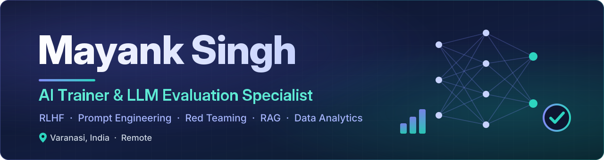

  

  
  
  
  
  

  

## 👋 About me

I test AI models and help make them better. For 4 years I've worked across AfterQuery, Handshake AI, Innodata, Tech Mahindra and Genpact.

I write adversarial prompts, coding challenges and image-based reasoning questions. Then I rate and rank model responses in English and Hindi. I check every claim and every agent tool call against its source.

Before AI training I was a data analyst. I built SQL and dbt pipelines and Tableau dashboards. As an ML intern at CRIS I built a RAG chatbot on fine-tuned open-source LLMs.

- 🔭 **Now:** AI Training Expert (multimodal evaluation) at **AfterQuery**
- 🎓 **MCA**, NIT Kurukshetra · published ML researcher
- 🗣️ English (fluent) · Hindi (native)
- 📍 Varanasi, India · open to remote roles

## 🧠 What I do

<table>
  <tr>
    <td width="33%" valign="top">
      <h3>🎯 LLM Evaluation</h3>
      RLHF rating and ranking 
      Rubric-based review 
      Agent trace review 
      Multilingual and multimodal evaluation
    </td>
    <td width="33%" valign="top">
      <h3>🛡️ Adversarial Testing</h3>
      Adversarial prompt design 
      Red teaming 
      Hallucination detection 
      Fact verification
    </td>
    <td width="33%" valign="top">
      <h3>📊 Data and ML</h3>
      RAG pipelines and LangChain 
      LoRA / PEFT fine-tuning 
      SQL, dbt and Snowflake 
      Tableau and Power BI dashboards
    </td>
  </tr>
</table>

## 🏆 Highlights

- 🥇 Promoted to **reviewer** at Handshake AI after passing the Hindi (Singapore) and English (India) reviewer assessments
- 🧩 Built image-based reasoning questions that **frontier models failed** at AfterQuery
- 🔗 Wrote multi-hop research questions that link facts from **3+ sources** to one verifiable answer
- ✅ Cleaned and validated **500K+ records at about 99% accuracy** at Genpact
- ⚡ Cut manual reporting work by **40%** and raised reporting reliability by **25%**
- 🤖 Built a **RAG chatbot** on fine-tuned Llama and Mistral and deployed it on Oracle Cloud
- 📄 **Published** a machine learning review paper in EPRA IJRD

## 🛠️ Tech stack

**Languages**

**AI / ML, data and tools**

  
  
  
  
  
  
  
  
  
  
  
  
  
  

## 💼 Experience

| When | Role | Company |
|---|---|---|
| Nov 2026 – Present | AI Training Expert, Multimodal Evaluation | **AfterQuery** |
| Jul 2026 – Oct 2026 | AI Fellow and Reviewer, Model Evaluation | **Handshake AI** |
| Mar 2026 – Jul 2026 | AI/LLM Analyst | **Innodata India** |
| May 2024 – Jun 2025 | Associate TAC Engineer | **Tech Mahindra** |
| Jan 2022 – Feb 2024 | Data Analyst | **Genpact India** |
| Jul 2021 – Dec 2022 | Machine Learning Intern | **CRIS** (Centre for Railway Information Systems) |

<b>See what I did in each role</b>

 

**AfterQuery** · AI Training Expert, Multimodal Evaluation (freelance)
- Create image-based reasoning questions that test the visual reasoning of frontier AI models.
- Keep only the questions that pass a strict difficulty check and that the models fail.
- Write a reference answer for every question and check each task against the quality rules.

**Handshake AI** · AI Fellow and Reviewer, Model Evaluation (freelance)
- Evaluated agentic AI assistants in code-mixed Hindi sessions built from a persona's emails, calendar, files and chats.
- Compared two responses per prompt on 8 quality dimensions. Checked every claim against the tool-call traces.
- Graded other contributors' tasks on a 1–5 scale and sent failing work back with written fixes.
- Wrote multi-hop research questions for a web-browsing LLM, with a golden trajectory for each task.
- Designed image-based Engineering and CS problems. Kept only those where both model attempts failed.

**Innodata India** · AI/LLM Analyst (contract)
- Rated generative AI outputs for safety, relevance and factual accuracy.
- Wrote gold-standard prompts and ideal responses. Ranked responses from several models side by side.
- Flagged hallucinations and factual errors in quality reports.

**Tech Mahindra** · Associate TAC Engineer
- Gave L1/L2 support for routers, switches and broadband devices within SLA targets.
- Troubleshot TCP/IP, VLAN, STP, DHCP, DNS and NAT issues. Ran incident analysis and RCA.

**Genpact India** · Data Analyst
- Integrated Salesforce CRM and ERP data in Snowflake with MDM. Built fact and dimension models with SQL and dbt.
- Automated reports, ETL jobs and validation checks in SQL and Python.
- Built Tableau dashboards and KPI scorecards for operations and management teams.

**CRIS** · Machine Learning Intern
- Built a helpdesk chatbot by fine-tuning Llama and Mistral with LoRA / PEFT.
- Designed a RAG pipeline with LangChain and a vector database that cited its sources.
- Deployed it on Oracle Cloud and tuned it to meet response-time targets.

## 🎓 Education

| Degree | Institute | Years |
|---|---|---|
| Master of Computer Applications (MCA) | National Institute of Technology (NIT), Kurukshetra | 2019 – 2022 |
| Bachelor of Computer Applications (BCA) | University of Allahabad | 2016 – 2019 |

## 📄 Publication

**A Review of Machine Learning Techniques for Subjective Answers Evaluation with Ontology** 
S. Singh, R. Yadav, M. K. Singh · *EPRA International Journal of Research & Development (IJRD)*, Vol. 6, Issue 2, Feb 2021 · [Google Scholar](https://scholar.google.com/citations?user=2dLtSw4AAAAJ)

## 📫 Let's talk

I'm open to AI training, LLM evaluation and data analyst roles. Remote is great.

📧 **mayanksinghrajput1202@gmail.com** · 📞 **+91-9450414658** · 💼 [LinkedIn](https://www.linkedin.com/in/mayank-singh-a0a727246)
